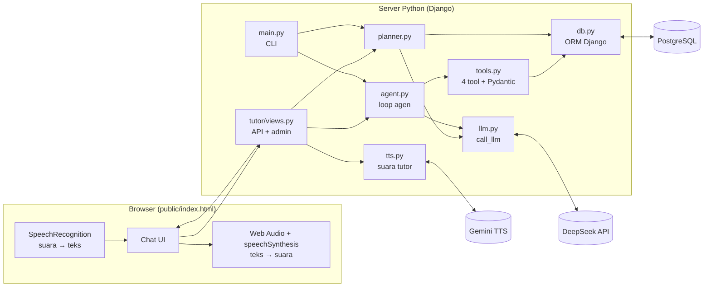
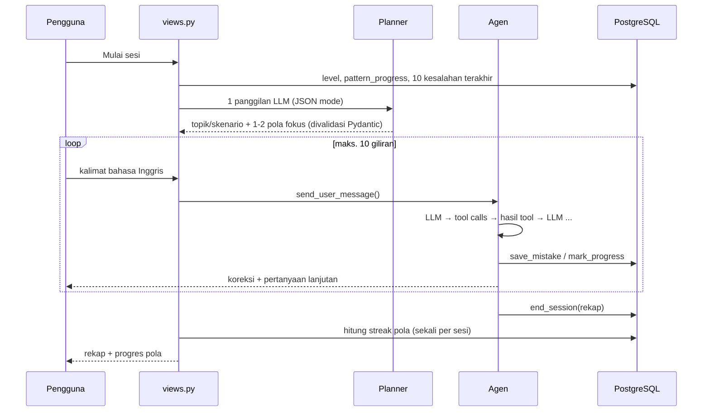

# AI English Tutor

Tutor percakapan bahasa Inggris berbasis **agen AI** untuk mahasiswa Indonesia. Pengguna bercakap
(lewat teks atau suara) dengan tutor yang mengoreksi kesalahan, mencatatnya ke database, dan
memakai catatan itu untuk merencanakan sesi berikutnya.

Proyek ini adalah portofolio belajar *agentic AI*: **tool calling, memori jangka panjang, dan planner**,
dengan loop agen yang ditulis manual (tanpa LangChain/LangGraph/CrewAI). Backend memakai **Django** (ORM, migrations,
panel admin); versi awal memakai FastAPI + SQL manual, lalu dimigrasi bertahap tanpa mengubah loop agen.

> 🎥 Video demo: _menyusul_

## Fitur

- **Tes penempatan** 5 soal (atau "mulai dari nol") untuk menentukan level: pemula, menengah, lanjut.
- **Planner**: sebelum sesi, LLM membaca riwayat kesalahan dan memilih topik/skenario serta 1–2 pola fokus.
- **Percakapan dengan agen** (maks. 10 giliran): agen memutuskan sendiri kapan memanggil tool untuk
  mencatat kesalahan, mencatat kemajuan, membaca riwayat, dan menutup sesi.
- **Dua gaya mentor**, dipilih pengguna: **galak** (tegas, boleh menyindir jawaban di level menengah ke atas)
  atau **lembut** (sabar, menyemangati). Gaya mengubah kata-kata tutor, ekspresi wajah, dan suaranya.
  Bahasa penjelasan mengikuti level
  (pemula: Indonesia, menengah: campuran, lanjut: English).
- **Pelacakan pola**: sebuah pola (mis. `simple past`) dianggap dikuasai setelah 3 sesi berturut-turut tanpa salah.
- **Mode suara**: tahan tombol (atau spasi) untuk bicara, lepas untuk mengirim. Speech-to-text memakai Web Speech API
  bawaan browser.
- **Suara tutor yang berekspresi** ([tts.py](tts.py)): balasan dibacakan **Gemini TTS** dengan logat Indonesia dan
  intonasi sesuai situasi: kesal saat mentor galak menegur, hangat saat mentor lembut mengoreksi, ceria saat kamu benar.
  Arahan gaya dikirim sebagai catatan sutradara, dan audio dialirkan sehingga tutor mulai bicara ±1 detik kemudian.
  Kuota gratis Gemini hanya 10 suara/hari, jadi Gemini dipakai untuk giliran yang emosinya penting; balasan lain,
  dan semua balasan setelah kuota habis, memakai suara browser.
- **Wajah tutor berekspresi**: marah 🔥 saat kamu salah, senang saat benar. Ekspresi **tidak ditebak dari
  teks**, melainkan diambil dari keputusan agen sendiri: giliran dengan `save_mistake` berarti marah.
- **Panel "Yang diingat tentang kamu"**: menampilkan memori jangka panjang agen (pola, streak, kesalahan terakhir).
- **Info kecepatan per giliran**: `dengar 0.4 s · agen 2.8 s (2× LLM, save_mistake ×2) · suara 0.2 s`,
  sekaligus memperlihatkan berapa kali LLM dipanggil dan tool apa saja yang dipakai agen.
- **Dua antarmuka, satu logika**: web (Django + satu halaman HTML/JS) dan CLI.
- **Panel admin** di `/admin/`: pelajar, sesi lengkap dengan percakapannya, kesalahan yang dicatat agen, dan progres pola.

## Arsitektur



`agent.py` tidak tahu apa-apa soal HTTP atau terminal. Ia hanya menyediakan `start_chat()`,
`send_user_message()`, dan `finish_chat()`. `main.py` (CLI) dan `tutor/views.py` (web) hanya menerjemahkan
input/output ke fungsi-fungsi tersebut.

## Alur satu sesi



## Loop agen

Inti agen ada di `agent_step()` ([agent.py](agent.py)). Satu giliran pengguna bisa memicu beberapa
panggilan LLM, karena LLM boleh meminta tool berkali-kali sebelum menjawab:

```python
for _ in range(MAX_TOOL_ROUNDS):              # pengaman agar tidak berputar tanpa henti
    resp = call_llm(messages, TOOLS)
    msg = resp.choices[0].message
    messages.append(msg)
    if not msg.tool_calls:                    # tidak minta tool -> ini jawaban akhir
        return msg.content
    for tc in msg.tool_calls:                 # jalankan tiap tool, kirim hasilnya balik ke LLM
        result = execute_tool(ctx, tc.function.name, tc.function.arguments)
        messages.append({"role": "tool", "tool_call_id": tc.id, "content": result})
```

Semua panggilan ke LLM lewat satu fungsi `call_llm()` ([llm.py](llm.py)) dengan retry 2x dan tanpa fallback model.

## Empat tool

Argumen dari LLM **selalu divalidasi Pydantic** ([tools.py](tools.py)). Jika tidak valid, pesan error
dikirim balik ke LLM sebagai hasil tool agar ia bisa memperbaiki argumennya sendiri, bukan membuat aplikasi crash.

| Tool | Argumen | Efek |
|---|---|---|
| `save_mistake` | `kalimat_asli, kalimat_benar, kategori, pola` | Simpan ke `mistakes`; streak pola direset ke 0 |
| `get_error_log` | `user_id` | Baca 20 kesalahan terakhir (hanya milik pengguna aktif) |
| `mark_progress` | `pola, benar` | Catat pola yang dipakai benar/salah di sesi ini |
| `end_session` | `ringkasan` | Simpan rekap: 3 kesalahan utama, 1 hal bagus, status pola |

`kategori` dibatasi ke `grammar`, `vocabulary`, `word_choice`, `sentence_structure` (Pydantic `Literal`
dan `CHECK` constraint di PostgreSQL). Nama pola dinormalisasi (huruf kecil, spasi tunggal) agar
`"Simple  Past"` dan `"simple past"` tercatat sebagai pola yang sama.

Streak **tidak** dinaikkan oleh LLM. LLM hanya melaporkan; kode yang menghitung di akhir sesi, sehingga
aturan "naik maksimal 1 per sesi, reset bila salah" selalu konsisten.

## Prompt caching

DeepSeek menyimpan cache untuk **awalan (prefix) prompt yang identik** antar-request. Karena itu prompt disusun:

```
[STATIS]  persona + aturan level + cara memakai tool   ← sama untuk semua pengguna → kena cache
[STATIS]  definisi 4 tool (urutan tetap)
[DINAMIS] user_id, level, topik, pola fokus, progres, kesalahan terakhir
[DINAMIS] riwayat percakapan
```

Hasil terukur saat pengujian: sejak giliran kedua, sekitar **90% token prompt kena cache**
(mis. `prompt=2368, cache_hit=2176`). Jalankan `uv run main.py --debug` untuk melihat angka ini per panggilan.

## Database

Enam tabel PostgreSQL, didefinisikan sebagai model Django di [tutor/models.py](tutor/models.py):
`Pelajar` (`users`), `Topik` (`curriculum_topics`), `Sesi` (`sessions`), `Pesan` (`messages`), `Kesalahan` (`mistakes`),
`ProgresPola` (`pattern_progress`). Constraint tetap dijaga di level database (`CHECK`, `UNIQUE`, `ON DELETE CASCADE`),
dan perubahan skema dicatat sebagai migration. Seluruh akses data tetap lewat satu pintu, [db.py](db.py), sehingga
agen tidak tahu ada ORM di baliknya. Contoh progres pola saat salah, pengganti `INSERT ... ON CONFLICT`:

```python
ProgresPola.objects.update_or_create(
    user_id=user_id, pola=pola,
    create_defaults={"jumlah_salah": 1, "streak_benar": 0, "sudah_dikuasai": False},          # baris baru
    defaults={"jumlah_salah": F("jumlah_salah") + 1, "streak_benar": 0, "sudah_dikuasai": False,  # baris lama
              "terakhir_muncul": Now()},
)
```

`F("jumlah_salah") + 1` dihitung di database, jadi tidak ada tambahan yang hilang walau dua request berjalan bersamaan.

## Menjalankan secara lokal

Prasyarat: Python 3.14, [uv](https://docs.astral.sh/uv/), PostgreSQL, dan API key DeepSeek.
API key Gemini opsional: tanpa key, tutor memakai suara browser.

```bash
uv sync
cp .env.example .env            # lalu isi DEEPSEEK_API_KEY, DATABASE_URL, dan (opsional) GEMINI_API_KEY

# buat database (sesuaikan user/password)
psql -U postgres -c "CREATE ROLE ai_tutor LOGIN PASSWORD 'password'"
psql -U postgres -c "CREATE DATABASE ai_english_tutor OWNER ai_tutor"
uv run python manage.py migrate                  # buat semua tabel + isi kurikulum 6 topik pemula
uv run python manage.py createsuperuser          # akun untuk panel admin /admin/

uv run python manage.py runserver                # web: buka http://localhost:8000
uv run main.py --debug                           # atau CLI, dengan log tool call dan token
```

Database lama yang dibuat dari `schema.sql` (sebelum Django) cukup diserahkan sekali ke Django dengan
`uv run python manage.py adopt_legacy_db`: perintah ini merapikan selisih kecil skema lalu menjalankan `migrate --fake-initial`.

Input suara hanya berjalan di **Google Chrome** atau **Microsoft Edge**, dan hanya di `localhost` atau HTTPS.

## Deploy (gratis): Netlify + Render + Neon

```
Browser ──► Netlify : halaman web (public/), HTTPS → mikrofon jalan
   └──────► Render  : backend Django (API, panel admin, suara Gemini)
               └──► Neon : PostgreSQL
```

Netlify tidak bisa menjalankan Django (hanya situs statis + function JS/TS/Go), jadi backend berjalan di Render.
Browser memanggil backend **langsung** (izin CORS untuk domain Netlify), bukan lewat proxy Netlify: proxy
memutus permintaan yang belum menjawab dalam ±26 detik, padahal server gratis Render yang tertidur butuh ±1 menit
untuk bangun. Saat halaman dibuka, frontend memanggil `/api/health` untuk membangunkannya dan menampilkan
pesan "server sedang bangun".

1. **Neon**: buat project PostgreSQL, salin connection string (berakhiran `?sslmode=require`).
2. **Render**: New → Blueprint → pilih repo ini; [render.yaml](render.yaml) dibaca otomatis. Isi env yang diminta:
   `DATABASE_URL` (Neon), `DEEPSEEK_API_KEY`, `GEMINI_API_KEY` (opsional), dan `FRONTEND_ORIGINS` (URL Netlify,
   bisa diisi setelah langkah 3). Build menjalankan `migrate`, yang sekaligus mengisi kurikulum (data migration).
3. **Netlify**: Add new site → import repo ini; [netlify.toml](netlify.toml) dibaca otomatis. Isi env `API_BASE`
   dengan URL Render (mis. `https://ai-english-tutor-api.onrender.com`), lalu deploy.
4. Isi `FRONTEND_ORIGINS` di Render dengan URL Netlify, lalu redeploy Render.
5. Akun panel admin: paket gratis Render tidak punya shell, jadi jalankan dari komputer sendiri dengan database Neon:
   `DATABASE_URL="<connection string Neon>" uv run python manage.py createsuperuser`, lalu buka `https://<render>/admin/`.

## Tes

```bash
uv run pytest                                  # 77 tes, ~3 detik, tanpa memanggil DeepSeek/Gemini
RUN_LIVE=1 uv run pytest tests/test_live.py    # tes perilaku model ke DeepSeek sungguhan (berbayar)
```

| Lapis | Isi |
|---|---|
| `test_unit.py` | Logika murni: penilaian tes, validasi argumen tool, mood, planner, susunan prompt dan naskah TTS |
| `test_db.py` | Fungsi ORM di `db.py` ke PostgreSQL: progres pola, streak sampai "dikuasai", constraint, cascade |
| `test_api.py` | Semua endpoint (lewat test client Django) dan loop agen penuh dengan **LLM tiruan** berjawaban terskrip, sehingga alur tool call → DB → mood → koreksi diuji secara deterministik; termasuk suara (Gemini tiruan), kuota habis, dan pembatasan sesi |
| `test_admin.py` | Panel admin: wajib login, setiap halaman daftar dan form terbuka |
| `test_live.py` | Perilaku DeepSeek sendiri: model tetap memanggil `save_mistake` di kedua gaya mentor. Menjaga regresi nyata saat sebuah instruksi prompt pernah membuat model berhenti mencatat kesalahan |

Tes database dan API memakai `DATABASE_URL`; pengguna buatan tes berawalan `pytest_` dan dihapus otomatis.

## Struktur proyek

```
agent.py         loop agen, prompt, state sesi (bebas I/O)
tools.py         4 tool: skema Pydantic + eksekutor
planner.py       perencana sesi (1 panggilan LLM, JSON mode, rencana cadangan deterministik)
placement.py     tes penempatan 5 soal, dinilai kode
llm.py           call_llm(): satu pintu ke DeepSeek
tts.py           suara tutor: Gemini TTS dengan catatan sutradara per mood & gaya mentor
db.py            satu pintu akses data (ORM Django)
main.py          antarmuka CLI
manage.py        perintah Django (runserver, migrate, createsuperuser, ...)
config/          project Django: settings.py, urls.py
tutor/           app Django: models, views (API), urls, admin, schemas (Pydantic), migrations,
                 management/commands/adopt_legacy_db.py
public/          halaman web tanpa framework: index.html, static/style.css, static/app.js,
                 static/config.js (alamat backend; ditulis ulang saat build di Netlify)
netlify.toml     deploy halaman web ke Netlify
render.yaml      deploy backend Django ke Render (gunicorn + WhiteNoise)
seed.sql         kurikulum pemula (kini juga diisi otomatis oleh data migration 0002)
schema.sql       skema awal (referensi; skema kini dikelola migration Django)
spike_m1.py      uji awal tool calling DeepSeek
tests/           77 tes pytest (unit, database, API + loop agen dengan LLM tiruan, admin) + tes live
```

## Keputusan desain dan batasan

- **Tanpa framework agen**, supaya setiap langkah loop (panggilan LLM, tool call, hasil tool) terlihat dan bisa dijelaskan.
- **Django untuk lapisan web, bukan untuk agen.** Migrasi dari FastAPI hanya mengganti `db.py` (SQL manual → ORM) dan
  lapisan HTTP (`app.py` → `tutor/views.py`). Loop agen, tool, dan planner tidak berubah, karena hanya bergantung
  pada fungsi-fungsi di `db.py`. Validasi request tetap memakai Pydantic, yang juga dipakai untuk argumen tool.
- **Tes penempatan dinilai kode, bukan LLM**, karena penempatan level perlu hasil yang konsisten.
- **Planner punya rencana cadangan deterministik**: jika output LLM tidak valid, sesi tetap berjalan.
- **Server stateless.** Percakapan yang sedang berjalan disimpan di kolom `sessions.state` (JSONB), bukan di memori:
  tiap request memuat state, menjalankan satu giliran, lalu menyimpannya lagi. Sesi tetap bertahan walau server
  restart, dan backend bisa dijalankan beberapa instance sekaligus.
- **Kunci sesi di database** (`sessions.busy_until`): dua pesan yang dikirim bersamaan ke satu sesi tidak saling
  menimpa; pesan kedua ditolak dengan 409. Kunci punya batas waktu, jadi lepas sendiri bila server mati di tengah proses.
- **Login hanya username** (tanpa password) sesuai cakupan MVP. Batas 3 sesi per hari (dihitung dalam WIB) per pengguna.
- **Suara Gemini dibatasi**: `/api/tts` hanya melayani pemilik sesi yang dibuat dalam 6 jam terakhir, agar kuota tidak
  dipakai pihak lain. Bila Gemini gagal atau kuota habis, browser otomatis memakai suara bawaannya.
- **Privasi suara**: di Chrome, audio mikrofon diproses oleh layanan Google; di Edge oleh layanan Microsoft.
- Tidak ada penilaian pelafalan; yang ditampilkan adalah transkrip hasil speech-to-text.

## Roadmap

- [x] M1 Spike tool calling DeepSeek
- [x] M2 Loop agen CLI + 4 tool + PostgreSQL
- [x] M3 Planner + tes penempatan + level
- [x] M4 FastAPI + halaman web
- [x] M5 Suara (Web Speech API)
- [x] Migrasi backend ke Django (ORM, migrations, panel admin) + suara tutor Gemini TTS
- [ ] M6 Deploy gratis (Netlify + Render + Neon) + uji coba dengan teman sekelas
