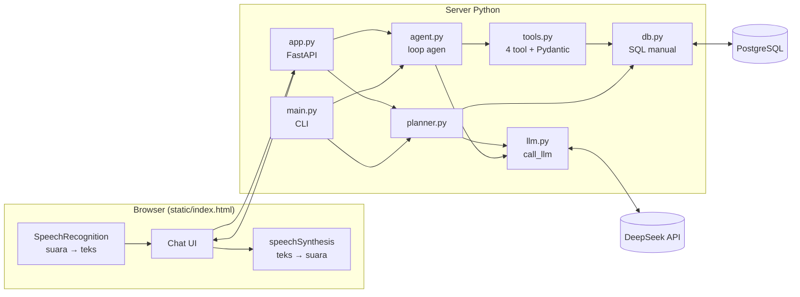
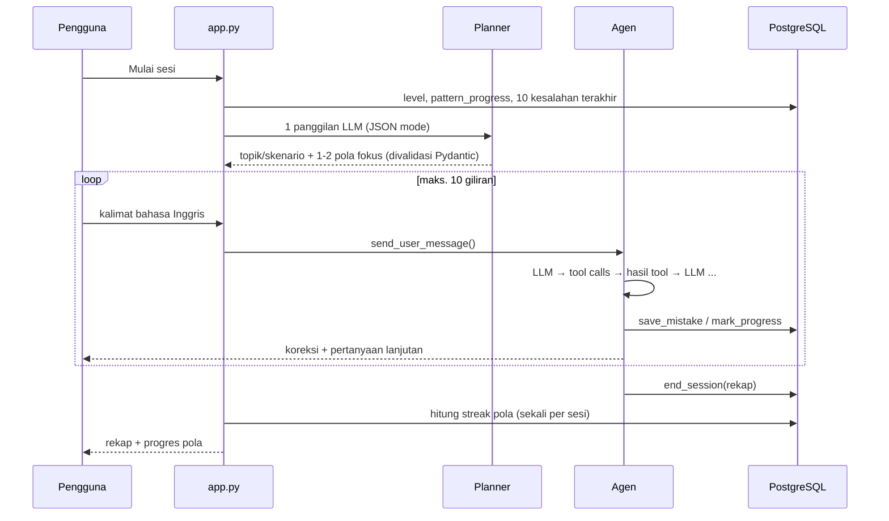

# AI English Tutor

Tutor percakapan bahasa Inggris berbasis **agen AI** untuk mahasiswa Indonesia. Pengguna bercakap
(lewat teks atau suara) dengan tutor yang mengoreksi kesalahan, mencatatnya ke database, dan
memakai catatan itu untuk merencanakan sesi berikutnya.

Proyek ini adalah portofolio belajar *agentic AI*: **tool calling, memori jangka panjang, dan planner**,
dengan loop agen yang ditulis manual (tanpa LangChain/LangGraph/CrewAI) dan SQL yang ditulis manual (tanpa ORM).

> 🎥 Video demo: _menyusul_

## Fitur

- **Tes penempatan** 5 soal (atau "mulai dari nol") untuk menentukan level: pemula, menengah, lanjut.
- **Planner**: sebelum sesi, LLM membaca riwayat kesalahan dan memilih topik/skenario serta 1–2 pola fokus.
- **Percakapan dengan agen** (maks. 10 giliran): agen memutuskan sendiri kapan memanggil tool untuk
  mencatat kesalahan, mencatat kemajuan, membaca riwayat, dan menutup sesi.
- **Persona dinamis**: tegas saat pengguna salah, santai saat benar. Bahasa penjelasan mengikuti level
  (pemula: Indonesia, menengah: campuran, lanjut: English).
- **Pelacakan pola**: sebuah pola (mis. `simple past`) dianggap dikuasai setelah 3 sesi berturut-turut tanpa salah.
- **Suara**: bicara lewat mikrofon (speech-to-text) dan balasan dibacakan (text-to-speech), keduanya
  memakai Web Speech API bawaan browser, tanpa biaya API tambahan.
- **Dua antarmuka, satu logika**: web (FastAPI + satu halaman HTML/JS) dan CLI.

## Arsitektur



`agent.py` tidak tahu apa-apa soal HTTP atau terminal. Ia hanya menyediakan `start_chat()`,
`send_user_message()`, dan `finish_chat()`. `main.py` (CLI) dan `app.py` (web) hanya menerjemahkan
input/output ke fungsi-fungsi tersebut.

## Alur satu sesi



## Loop agen

Inti agen ada di `agent_step()` ([agent.py](agent.py)). Satu giliran pengguna bisa memicu beberapa
panggilan LLM, karena LLM boleh meminta tool berkali-kali sebelum menjawab:

```python
for _ in range(MAX_TOOL_ROUNDS):              # pengaman agar tidak berputar tanpa henti
    resp = call_llm(messages, TOOLS)
    msg = resp.choices[0].message
    messages.append(msg)
    if not msg.tool_calls:                    # tidak minta tool -> ini jawaban akhir
        return msg.content
    for tc in msg.tool_calls:                 # jalankan tiap tool, kirim hasilnya balik ke LLM
        result = execute_tool(ctx, tc.function.name, tc.function.arguments)
        messages.append({"role": "tool", "tool_call_id": tc.id, "content": result})
```

Semua panggilan ke LLM lewat satu fungsi `call_llm()` ([llm.py](llm.py)) dengan retry 2x dan tanpa fallback model.

## Empat tool

Argumen dari LLM **selalu divalidasi Pydantic** ([tools.py](tools.py)). Jika tidak valid, pesan error
dikirim balik ke LLM sebagai hasil tool agar ia bisa memperbaiki argumennya sendiri, bukan membuat aplikasi crash.

| Tool | Argumen | Efek |
|---|---|---|
| `save_mistake` | `kalimat_asli, kalimat_benar, kategori, pola` | Simpan ke `mistakes`; streak pola direset ke 0 |
| `get_error_log` | `user_id` | Baca 20 kesalahan terakhir (hanya milik pengguna aktif) |
| `mark_progress` | `pola, benar` | Catat pola yang dipakai benar/salah di sesi ini |
| `end_session` | `ringkasan` | Simpan rekap: 3 kesalahan utama, 1 hal bagus, status pola |

`kategori` dibatasi ke `grammar`, `vocabulary`, `word_choice`, `sentence_structure` (Pydantic `Literal`
dan `CHECK` constraint di PostgreSQL). Nama pola dinormalisasi (huruf kecil, spasi tunggal) agar
`"Simple  Past"` dan `"simple past"` tercatat sebagai pola yang sama.

Streak **tidak** dinaikkan oleh LLM. LLM hanya melaporkan; kode yang menghitung di akhir sesi, sehingga
aturan "naik maksimal 1 per sesi, reset bila salah" selalu konsisten.

## Prompt caching

DeepSeek menyimpan cache untuk **awalan (prefix) prompt yang identik** antar-request. Karena itu prompt disusun:

```
[STATIS]  persona + aturan level + cara memakai tool   ← sama untuk semua pengguna → kena cache
[STATIS]  definisi 4 tool (urutan tetap)
[DINAMIS] user_id, level, topik, pola fokus, progres, kesalahan terakhir
[DINAMIS] riwayat percakapan
```

Hasil terukur saat pengujian: sejak giliran kedua, sekitar **90% token prompt kena cache**
(mis. `prompt=2368, cache_hit=2176`). Jalankan `uv run main.py --debug` untuk melihat angka ini per panggilan.

## Database

Enam tabel PostgreSQL ([schema.sql](schema.sql)): `users`, `curriculum_topics`, `sessions`, `messages`,
`mistakes`, `pattern_progress`. Seluruh query ada di [db.py](db.py). Contoh upsert progres pola:

```sql
INSERT INTO pattern_progress (user_id, pola, jumlah_salah, streak_benar, sudah_dikuasai)
VALUES (%s, %s, 1, 0, false)
ON CONFLICT (user_id, pola) DO UPDATE SET
    jumlah_salah = pattern_progress.jumlah_salah + 1,
    streak_benar = 0, sudah_dikuasai = false, terakhir_muncul = now()
```

## Menjalankan secara lokal

Prasyarat: Python 3.14, [uv](https://docs.astral.sh/uv/), PostgreSQL, dan API key DeepSeek.

```bash
uv sync
cp .env.example .env            # lalu isi DEEPSEEK_API_KEY dan DATABASE_URL

# buat database (sesuaikan user/password)
psql -U postgres -c "CREATE ROLE ai_tutor LOGIN PASSWORD 'password'"
psql -U postgres -c "CREATE DATABASE ai_english_tutor OWNER ai_tutor"
psql -U ai_tutor -d ai_english_tutor -f schema.sql
psql -U ai_tutor -d ai_english_tutor -f seed.sql

uv run uvicorn app:app --reload  # web: buka http://localhost:8000 (API docs: /docs)
uv run main.py --debug           # atau CLI, dengan log tool call dan token
```

Input suara hanya berjalan di **Google Chrome** atau **Microsoft Edge**, dan hanya di `localhost` atau HTTPS.

## Struktur proyek

```
agent.py         loop agen, prompt, state sesi (bebas I/O)
tools.py         4 tool: skema Pydantic + eksekutor
planner.py       perencana sesi (1 panggilan LLM, JSON mode, rencana cadangan deterministik)
placement.py     tes penempatan 5 soal, dinilai kode
llm.py           call_llm(): satu pintu ke DeepSeek
db.py            semua query SQL + connection pool
app.py           API FastAPI + penyaji halaman web
main.py          antarmuka CLI
static/index.html  halaman web (HTML/CSS/JS tanpa framework)
schema.sql, seed.sql
spike_m1.py      uji awal tool calling DeepSeek
```

## Keputusan desain dan batasan

- **Tanpa framework agen**, supaya setiap langkah loop (panggilan LLM, tool call, hasil tool) terlihat dan bisa dijelaskan.
- **Tes penempatan dinilai kode, bukan LLM**, karena penempatan level perlu hasil yang konsisten.
- **Planner punya rencana cadangan deterministik**: jika output LLM tidak valid, sesi tetap berjalan.
- **State sesi aktif disimpan di memori server.** Jika server restart, sesi yang sedang berjalan hilang
  (data di database tetap aman). Cukup untuk skala uji coba; bisa dibangun ulang dari tabel `messages` bila dibutuhkan.
- **Login hanya username** (tanpa password) sesuai cakupan MVP. Batas 3 sesi per hari per pengguna.
- **Privasi suara**: di Chrome, audio mikrofon diproses oleh layanan Google; di Edge oleh layanan Microsoft.
- Tidak ada penilaian pelafalan; yang ditampilkan adalah transkrip hasil speech-to-text.

## Roadmap

- [x] M1 Spike tool calling DeepSeek
- [x] M2 Loop agen CLI + 4 tool + PostgreSQL
- [x] M3 Planner + tes penempatan + level
- [x] M4 FastAPI + halaman web
- [x] M5 Suara (Web Speech API)
- [ ] M6 Deploy ke VPS (HTTPS, PostgreSQL hanya di localhost) + uji coba dengan teman sekelas
